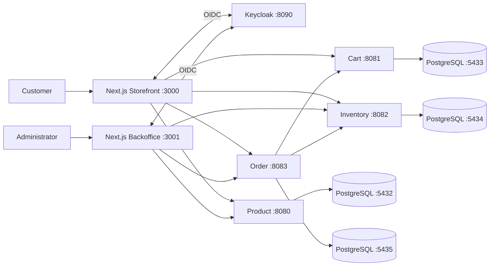

# Microservices Shop

A personal e-commerce project built to demonstrate a purchase flow across independently owned services. Inspired by [YAS by NashTech Garage](https://github.com/nashtech-garage/yas), this repository contains a separate implementation for learning and portfolio demonstrations.

**Implemented:** product catalog, persistent cart, stock reservation, idempotent checkout, customer Storefront, administrator Backoffice, and local Keycloak sign-in. Payment, search, deployment, and observability are planned work.

## Architecture



Each Java service owns a PostgreSQL database. Flyway creates its schema and seed data. The Next.js apps expose server-side BFF routes for their screens.

| Component | Responsibility | Main endpoints |
| --- | --- | --- |
| Product Service | Seeded catalog | `GET /products` |
| Cart Service | Store items and accumulate quantities | `POST /carts/{cartId}/items`, `GET /carts/{cartId}` |
| Inventory Service | Read stock and reserve it per checkout key | `GET /inventory/{productId}`, `POST /reservations` |
| Order Service | Read cart, reserve stock, persist order | `POST /checkouts`, `GET /orders/{orderId}` |
| Storefront | Customer UI and BFF | `/api/catalog`, `/api/carts/{cartId}`, `/api/checkout` |
| Backoffice | Admin UI and BFF | `/api/overview`, `/api/orders/{orderId}` |
| Keycloak | OIDC login and realm roles | Realm `shop` |

The catalog and Backoffice overview BFFs combine Product and Inventory responses. Storefront checkout requires `shop-customer`; Backoffice pages and API routes require `shop-admin`. Dependency failures are returned as errors rather than replaced with placeholder data.

## Technology

- Java 25, Spring Boot 4.0.8, Maven, PostgreSQL 17, Flyway, Testcontainers
- Next.js 16.4.6, React 19.3.1, TypeScript, Auth.js 5 beta, npm workspaces
- Keycloak 26.8.2 and Docker Compose

## Run locally

**Prerequisites:** JDK 25, Maven 3.6.3+, Node.js 24, npm, and Docker with Compose. The following ports must be free: `3000`, `3001`, `5432`–`5435`, `8080`–`8083`, and `8090`.

From the repository root, start four databases and Keycloak:

```sh
docker compose up -d
docker compose ps
```

Run each Java service in its **own terminal**, from the repository root:

```sh
mvn -f product-service/pom.xml spring-boot:run
mvn -f cart-service/pom.xml spring-boot:run
mvn -f inventory-service/pom.xml spring-boot:run
mvn -f order-service/pom.xml spring-boot:run
```

Install frontend dependencies and generate local Auth.js settings:

```sh
npm ci
npm run setup:local
```

`setup:local` creates ignored `apps/*/.env.local` files from the checked-in examples with a random `AUTH_SECRET` for each app. It preserves existing files. On PowerShell, use `npm.cmd` if the execution policy blocks `npm.ps1`.

Start the apps in **two more terminals**:

```sh
npm run dev:storefront
npm run dev:backoffice
```

Open [Storefront](http://localhost:3000), [Backoffice](http://localhost:3001), or the [Keycloak Admin Console](http://localhost:8090/admin). The local Keycloak administrator is `admin` / `admin`.

| Demo user | Password | Realm role | App |
| --- | --- | --- | --- |
| `customer` | `Customer123!` | `shop-customer` | Storefront |
| `shopadmin` | `Admin123!` | `shop-admin` | Backoffice |

The checked-in demo credentials and OIDC client secrets are **for local development only**. Replace them before any shared or public deployment.

### Quick checks

```sh
curl http://localhost:8080/products
curl http://localhost:3000/api/catalog
```

Both responses should contain two seeded products: `Áo thun` (199000.00) and `Túi vải` (99000.00). The BFF catalog also includes `available` stock. Unauthenticated Storefront checkout and Backoffice data requests return `401`.

## Demo: repeated checkout

In Storefront, add a product, sign in as `customer`, and create an order. The confirmation displays the order ID and lets you submit the **same checkout key** again. The second request returns the same order without another stock deduction.

You can also demonstrate this directly through the Java APIs. Run this PowerShell example with Cart, Inventory, and Order running:

```powershell
$before = Invoke-RestMethod http://localhost:8082/inventory/1
$cartId = [guid]::NewGuid().ToString()
$key = [guid]::NewGuid().ToString()

$item = @{ productId = 1; quantity = 2 } | ConvertTo-Json -Compress
Invoke-RestMethod -Method Post -Uri "http://localhost:8081/carts/$cartId/items" -ContentType 'application/json' -Body $item

$body = @{ checkoutKey = $key; cartId = $cartId } | ConvertTo-Json -Compress
$first = Invoke-RestMethod -Method Post -Uri 'http://localhost:8083/checkouts' -ContentType 'application/json' -Body $body
$second = Invoke-RestMethod -Method Post -Uri 'http://localhost:8083/checkouts' -ContentType 'application/json' -Body $body
$after = Invoke-RestMethod http://localhost:8082/inventory/1

$first.orderId -eq $second.orderId
$before.available - $after.available
```

The last two lines should print `True` and `2`. Product 1 starts with 10 units in a fresh database; previous demo runs may have changed its balance. Inventory records a reservation per `checkoutKey` and rejects the key with different items. Order stores the key uniquely, returns the existing order for a repeat request, and rejects reuse for another cart.

## Tests

```sh
mvn clean verify
npm test
npm run build
```

The Java suite includes PostgreSQL integration tests through Testcontainers, so Docker must be running. The frontend suite tests route behavior and role checks. The production build checks both Next.js apps and TypeScript. For an interactive smoke test, sign in with both demo accounts, confirm that `customer` cannot read Backoffice data, and repeat a checkout.

## Repository layout

```text
apps/storefront/       Customer UI, Auth.js, catalog/cart/checkout BFF
apps/backoffice/       Admin UI, Auth.js, overview/order BFF
product-service/       Catalog and seed migration
cart-service/          Persistent carts
inventory-service/     Stock and idempotent reservations
order-service/         Checkout orchestration and orders
keycloak/              Importable local realm
scripts/               Local environment setup
compose.yaml           PostgreSQL instances and Keycloak
```

## Current limitations and roadmap

This is a local demo. Compose starts databases and Keycloak; the Java and Next.js processes run separately. Java API ports are directly accessible and do not validate Keycloak tokens. Cart IDs live in the browser, and the Cart API has no account ownership check. There is no cross-service compensation if a reservation succeeds and order persistence subsequently fails. Internal network restrictions, service-level authorization, and recovery are required before public deployment.

Planned work includes sandbox payment, shipping, promotions, reviews, recommendations, Kafka events, Elasticsearch search, service Docker images, GitHub Actions, Kubernetes with Helm, and OpenTelemetry with Prometheus, Grafana, Loki, and Tempo. **These integrations are not implemented yet.**

To stop local infrastructure, run `docker compose down`. Adding `-v` also deletes all four PostgreSQL volumes and their demo data.
